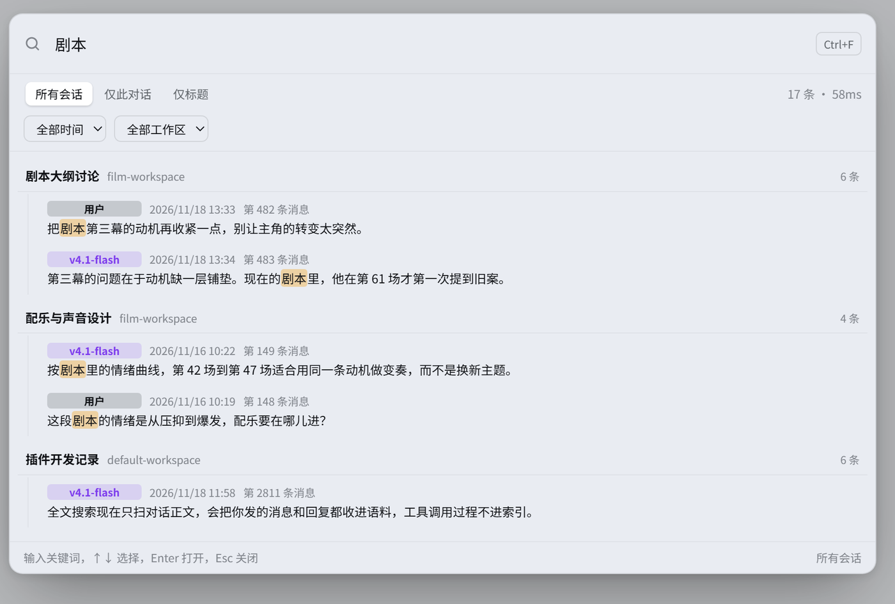
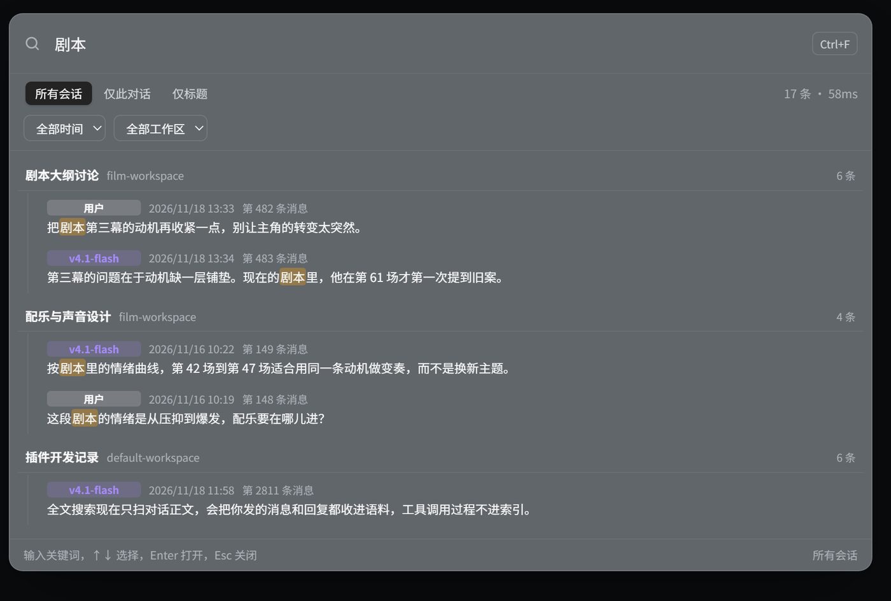

# dsh-session-search

DSH（DeepSeek Harness）的跨会话全文搜索浮窗：`Ctrl+F` 打开，搜所有会话的完整正文，命中按会话分组，点一条直接切过去并定位到那句话。



<details>
<summary>深色主题</summary>



</details>

> 截图里是虚构的示例内容。

## 为什么不直接用自带的会话搜索

DSH 自带的搜索建在 SQLite FTS5 上，分词器是 `unicode61`：连续汉字被当成**一个 token**。实测（`cache/session-search.db`，11.2 万条文档）：

| 查询 | 命中 | 耗时 |
| --- | --- | --- |
| `妇好` | 20 | 1.1 ms |
| `好修` | 0 | 0.1 ms |
| `妇` | 0 | 0.0 ms |

只有「整段汉字恰好是一个独立词」才搜得到，词内片段一律 0 命中。换 FTS5 的 `trigram` 也不够：它要求查询 ≥3 字，中文两字词（配乐 / 剧本 / 分镜）全废。

所以这里不用分词索引，自建一份「语料 + 偏移表」，查询时做字节级子串扫描：

- `corpus.bin` — 所有可检索正文按 UTF-8 顺序追加；
- `docs.jsonl` — 每条正文一行：会话 id、seq、类型、时间、在 corpus 里的起止、代际；
- `state.json` — 每个会话日志文件的 size/mtime/代际，用来增量追平。

实测规模：321 个会话、294 MB 压缩日志，语料 29 MB（只收用户消息与助手正文），建库 12 s，查询 20–80 ms，`好修` 这种两字片段能正常命中。

## 安装

插件市场（dsh.market）里搜 `dsh-session-search`，或在 DSH 的插件页安装 npm 包：

```sh
dsh plugin install dsh-session-search          # 按你的 DSH 版本选择命令
```

本地开发用 `link:` 依赖挂进 profile 的 `dsh.profile.bundles`，改完重启 DSH 生效。

## 用法

- 默认 `Ctrl+F` / `Cmd+F`，或会话头部右侧的放大镜按钮。快捷键可改：点浮窗右上角的 `Ctrl+F` 徽标，变成「按下组合键…」时按你要的组合（必须带 Ctrl/Alt/Shift 之一），存在 localStorage，Esc 取消。
- `所有会话` / `仅此对话` / `仅标题` 三档范围。`仅标题` 只匹配会话标题，每个会话出一条，点开停在正文最新处。
- `↑` `↓` 选择，`Enter` 打开，`Esc` 关闭。
- 空白页给「最近搜过」（点一下重搜，`×` 删单条，`清空` 全删，最多 8 个）与「最近会话」（点一下直接打开）。
- 过滤器：时间范围（全部 / 今天 / 近 7 天 / 近 30 天 / 自定义起止日期）、工作区（按 cwd）。两者都传到宿主侧参与筛选，不是拿到结果后再筛。
- 每条结果左侧一颗标签：用户消息写「用户」，助手消息写回答它的模型名（去掉 `deepseek-` 前缀，完整名在悬停提示里），标题搜索写「标题」。标签固定 96px 宽，所以右边的时间与「第 N 条消息」每行对齐。
- 助手标签按**模型族**换色，不按模型名：deepseek 紫、MiniMax 绿、spark 琥珀、GPT 蓝、豆包红、其他灰。主题里可用的语义色只有五六种，十几个模型逐个上色必然撞色。
- 配色全部走主题令牌（`--dsw-alias-*`），亮色/暗色跟随宿主；浮层挂在 body 上，原生下拉与日期控件靠 `color-scheme` 跟随，切主题时用 MutationObserver 同步。
- 点一条结果：切到那个会话，把命中的那句话滚到屏幕中间并高亮 6 秒；目标消息还没加载进 DOM 时先滚到顶部触发加载再找。
- 跨工作区：点别的项目里的会话时先连上它所在的工作区再切；失败会 toast 说明原因。
- 索引没建好时顶部显示 `正在建索引 12/305`，建完自动重搜。

## 结果怎么排

扫完整个语料再排序，不是「扫到够数就停」（那样只会返回最老的会话）：

1. 每个文档最多一条命中，每个会话最多 6 条——留最新的 6 条，不是最先扫到的 6 条；
2. 消息时间倒序，最新会话在最上面，`mnemon-run-*` 这类内部子会话排最后；
3. 同一会话内也按时间倒序，最新那条在前。

## 搜什么

只收两类正文：用户发的消息、助手回的正文。

- 不收工具调用参数、工具结果、reasoning、技能目录与技能正文——那些是中间过程，不是对话。
- 只收工作区记录里登记过、且没归档的会话（`$DSH_HOME/storages/workspace.json`）。磁盘上残留的子会话和已归档会话点了打不开，索引时直接标掉。

## 定位是怎么做的

语料里是 markdown 原文，屏幕上是渲染后的 DOM：`**` `|` `#` 这些符号没了，空白也不一样。所以两边都压成「去掉空白和 markdown 符号」的扁平串再比：

1. 用命中的 anchor（命中前后 40/60 字的原文）在扁平串里找；
2. 先整段找，找不到把窗口缩到 ±26 / ±16 / ±10 字再找；
3. 都找不到才退化成关键词，而且**整页只有一处出现**才高亮——满屏都是这个词时宁可不定位，也不高亮错地方；
4. 目标消息在更早的分页里时，每 0.7 s 往顶部推一次触发加载，最多等 28 s；连推 8 次页面高度不变就认为没有更早的了。

## 索引维护

- 插件启动 3 秒后在后台追平一次，只重读 size/mtime 变过的会话日志。
- 会话日志被压缩重写（变小）时该会话旧正文标作废（代际 +1）；作废字节超过语料 30% 时整库重建。
- 手动重建：`GET /api/dsh-session-search/reindex`。

## 隐私

全部在本机完成：插件只读 `$DSH_HOME/sessions` 下的会话日志，索引写在 `$DSH_HOME/cache/session-search-panel/`，不发任何网络请求。

## 已知限制

- 定位靠文本匹配而非真锚点：DSH 的对话流没有按 seq 的 DOM 属性（只有 `data-conversation-session` / `data-conversation-scroll` / `data-conversation-region`），也没有 `scrollIntoView` 之类接口。
- 很老的会话要连续向上翻页才能找到那句话，超过约 28 s 放弃定位，只切会话。
- 只索引本机 `$DSH_HOME/sessions`，不含远程设备。
- 排查「点了没反应」看 `$DSH_HOME/cache/session-search-panel/diag.log`，它记录每次点击走到了哪一步（`open-ok` / `open-failed` / `connect-workspace` / `no-switch`）与服务探测结果。

## English

Cross-session full-text search overlay for [DeepSeek Harness](https://github.com/deepseek-ai). Press `Ctrl+F`, search the full text of every past session (Chinese substring search works — the built-in FTS5 tokenizer cannot match inside a run of Han characters), and jump to the exact message with a highlight.

It builds its own corpus + offset index instead of a tokenizer index, so any substring matches. Everything stays local: it reads `$DSH_HOME/sessions` and writes its index under `$DSH_HOME/cache/session-search-panel/`.

## 开发

```
index.js         宿主侧：HTTP 路由 /api/dsh-session-search/{search,status,workspaces,reindex,diag} + 索引维护
client.js        客户端：浮窗、快捷键、分组列表、定位与高亮
cordis.patch.yml 插件注册
docs/            README 截图与生成脚本产物
```

`node --check index.js client.js` 可做语法自检；`internals` 导出了 `ensureIndex / runSearch / refreshIndex / listSessionLogs / build / handle`，方便在 node 里直接调。

## License

MIT
